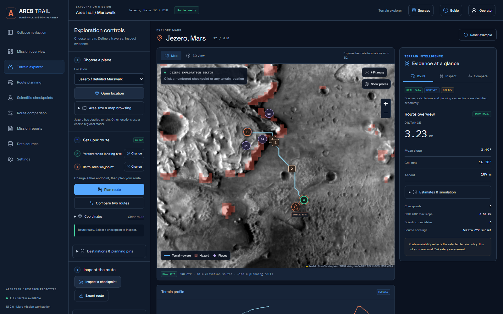

<div align="center">
  
  <h1>ARES TRAIL</h1>
  <p><strong>Marswalk Mission Planner</strong></p>
  <p>Explore the terrain. Compare the routes. Inspect the evidence.</p>
  <p>
    <a href="https://nasaapp-xi.vercel.app/">Live application</a> &middot;
    <a href="docs/SCIENCE_METHOD.md">Scientific method</a> &middot;
    <a href="docs/DATA_CARDS.md">NASA datasets</a> &middot;
    <a href="docs/ARCHITECTURE.md">Architecture</a>
  </p>
</div>



ARES TRAIL brings real Mars imagery, elevation data and route inspection into one map-first workspace. Choose a region, compare candidate traverses, examine observations at checkpoints, and export the reasoning behind a plan.

Built around the NASA Space Apps challenge **[Interplanetary Survival Guide: Martian Map](https://www.spaceappschallenge.org/2026/challenges/interplanetary-survival-guide-martian-map/)**.

> **Research and educational prototype.** This is an independent project, not an official NASA application or an operational astronaut navigation or safety system.

## Explore the application

| Workspace | What you can do |
| --- | --- |
| **Mission Overview** | Review the current route, terrain indicators, checkpoints, coverage and session activity. |
| **Terrain Explorer** | Navigate the live 2D map, switch to 3D, inspect elevation/slope profiles and control layers. |
| **Route Planning** | Choose endpoints on the map or by coordinates, swap A/B, select destinations and adjust prototype slope/relief weights. |
| **Scientific Checkpoints** | Examine available imagery, observation dates, terrain measurements and rover panoramas; record inspection notes. |
| **Route Comparison** | Compare distance-focused and terrain-aware alternatives using calculated measurements, charts and overlays. |
| **Mission Reports** | Review the current plan and its assumptions, export JSON, or print/save a report as PDF. |
| **Sources and Settings** | Inspect active data provenance, change layer visibility and tune planning preferences. |

### Planning made easier

- **First-visit guidance:** a skippable welcome, an illustrative arrival animation and a twelve-step tour. Use **Guide** to replay it. Reduced-motion preferences are respected.
- **Destination shortcuts:** choose the Perseverance landing reference, an example delta waypoint or labeled DEM-derived investigation candidates.
- **Planning pins:** drop a pin, enter coordinates or right-click the 2D map for location actions. Save up to 20 browser-local bookmarks and include them in route JSON.
- **Map key:** A/B identify endpoints, D identifies destination shortcuts, and P identifies your pins. The lander marks the published Perseverance landing coordinate.
- **Preference presets:** start with Default, Lower slopes or Lower relief, then tune the sliders. Recalculate after changing preferences.
- **Progressive disclosure:** expand advanced controls when needed. Checkpoint images and the 3D renderer load on request.

Pins are bookmarks, not a multi-stop itinerary. Investigation candidates are terrain hypotheses, not confirmed discoveries or verified access points.

## Run locally

The prepared frontend is included. **No NASA credentials, original-data downloads, frontend build or backend server are required to run the planner.**

With Git and Python 3 installed:

```sh
git clone https://github.com/codedbyanik/nasaapp.git
cd nasaapp
python -B -m http.server 8000 --bind 127.0.0.1
```

Open **http://127.0.0.1:8000**. Use HTTP: opening the HTML file directly cannot reliably load JSON datasets.

For development and testing, install Node.js/npm as well:

```sh
npm ci
npm start
```

The start command runs the same Python server. Leaflet loads from an external CDN, and uncached remote map/imagery tiles need internet access. Fonts, icons, Three.js and prepared local products are bundled. This is not a fully offline application.

## Try a mission

1. **Start in Jezero.** Follow the welcome tour or choose Skip and explore. An example terrain-aware route loads automatically.
2. **Choose a destination.** Use Change beside A/B and click the map, or open **Destinations & planning pins** for shortcuts, coordinate entry and swapping.
3. **Calculate and compare.** Select Plan route or Compare two routes. Inspect distance, ascent, slope and the profiles below the map.
4. **Look before walking.** Select a numbered checkpoint. Compare observations, expand source/date information and inspect supported rover photographs.
5. **Record your reasoning.** Add notes describing visible features, uncertainty and follow-up questions.
6. **Explore in 3D.** Rotate, zoom, frame the route and switch surface styles. Vertical exaggeration changes the display, not the measurements.
7. **Export the plan.** Open Mission Reports for JSON export or print/save-PDF. Use Sources to inspect products, hashes and limitations.

**Export inspection notes before reloading or replanning.** Reviews live in memory and route changes reset them. Planning pins use separate browser-local storage when available; they are not a shared mission database.

## NASA data and coverage

| Source | Used for | Resolution and scope |
| --- | --- | --- |
| [MRO CTX stereo terrain model](https://doi.org/10.5066/P906QQT8) | Jezero elevation, slope/relief, routing and 3D | 20 m source elevation, aggregated to approximately 100 m planning cells. |
| [MRO CTX orthorectified mosaic](https://doi.org/10.5066/P9GV1ND3) | Jezero imagery and checkpoint context | 6 m source imagery; display and previews have their own sampling. |
| [MGS MOLA MEGDR products](https://pds-geosciences.wustl.edu/missions/mgs/megdr.html) | Jezero regional context and global planning | Approximately 463 m context near Jezero; approximately 3.7 km regional planning cells globally. |
| [MRO HiRISE](https://www.uahirise.org/) | Footprint-matched checkpoint imagery | Four curated observations. Source/preview resolutions, dates and IDs appear in the inspector. |
| [Perseverance Mastcam-Z](https://www.jpl.nasa.gov/images/pia24264-mastcam-zs-first-360-degree-panorama/) | Landing-site and regional delta surface context | Two published panoramas with their location associations explicitly labeled. |
| [Caltech/Murray Lab Global CTX Mosaic V01](https://murray-lab.caltech.edu/CTX/V01/TilePages/) | Regional orbital imagery in 3D | NASA-derived 5 m source imagery, requested at coarser preview levels; it does not refine MOLA terrain. |
| [Viking MDIM 2.1 via OpenPlanetaryMap](https://openplanetarymap.org/basemaps/mars/opm-mars-viking-mdim21/) | Global browsing basemap | Visual context, separate from the routing elevation model. |

The Jezero study area spans latitude **18.30-18.60 N** and east longitude **77.17-77.69**. HiRISE products are ESP_094047_1985, ESP_093981_1985, ESP_073068_1985 and ESP_073912_1985. Surface products are PIA24264 and PIA24921.

### Detailed Jezero versus regional exploration

Jezero supports the detailed evidence workflow. Gale, Olympus Mons and custom regions use global MOLA elevation/count grids and provide **coarse reconnaissance corridors**. They cannot resolve local walking hazards. Regional walking-time and oxygen estimates are unavailable; Jezero observations are not reused as regional photographs.

Regional bounds support longitude wrapping and antimeridian crossings. Planning is limited to the loaded region, rather than planet-wide optimization or polar navigation. CTX context is cached for the default Gale/Olympus views; other footprints may require the external service.

The observation catalog is a **curated historical snapshot**, not an exhaustive archive search, live weather feed or guarantee of the latest image. Product references, metadata and checksums are retained in:

- [Jezero terrain manifest](data/processed/nasa/manifest.json)
- [Observation catalog](data/processed/nasa/observations.json)
- [Regional MOLA manifest](data/processed/global/manifest.json)
- [Global CTX imagery manifest](data/processed/imagery/global_ctx_manifest.json)

## How routing works

A* compares a distance-focused route with a terrain-aware alternative. Both share coverage and exclusion constraints. Terrain-aware routing adds weighted slope and elevation-residual relief terms; regional routing also penalizes interpolated zero-count MOLA bins.

Detailed Jezero cells reaching the prototype **20-degree native maximum-slope policy**, along with unknown terrain, are excluded. Regional slopes come from a coarse grid and do not establish maximum slopes inside each kilometer-scale cell. Route segments are checked against the grid's constraints.

The comparison's **unweighted slope/relief index** is a descriptive proxy, not the weighted A* objective or an astronaut safety score. Evaluation examines selected corridors and weight sensitivity; it is not independent operational validation.

Read [Scientific method and limitations](docs/SCIENCE_METHOD.md) for processing, equations and evaluation scope.

## Scientific limits

- **Terrain resolution:** individual rocks, soft soil, narrow hazards and small steep faces may be unresolved. Imagery cannot add missing elevation measurements.
- **Prototype policy:** thresholds, weights and presets are assumptions, not validated EVA constraints.
- **Consumables:** local estimates assume 3 km/h, 0.8 kg O2/hour and a 30% oxygen reserve. They exclude terrain-dependent physiology and return travel.
- **Science interpretation:** candidates are DEM-derived hypotheses. Mineral detections and candidate detour access are unconfirmed.
- **Operational coverage:** no live weather, radiation, thermal/mineral raster, communications assessment, suit telemetry or emergency/return planning is connected.
- **Visualizations:** the landing intro and rover traversal are illustrative. The obstacle event is synthetic; no physical hardware or calibrated waypoint follower is connected.

If required terrain fails to load, planning is disabled instead of substituting fabricated costs. Missing image evidence is reported rather than replaced with unrelated imagery.

## Project structure

```text
nasaapp/
|-- index.html               Static application entry point
|-- src/
|   |-- app.js               Map and planner orchestration
|   |-- core/                Routing and measurements
|   |-- features/            Observations, regions and planning tools
|   |-- terrain/             3D viewer, geometry and imagery
|   |-- ui/                  Workspace, icons and guidance
|   `-- styles/              Base styles and workstation theme
|-- assets/                  Favicon and licensed vendor dependencies
|-- backend/                 Optional Flask summary API
|-- scripts/
|   |-- data/                Source downloads and preparation
|   `-- evaluation/          Route evaluation and scientific figures
|-- data/processed/          Prepared products and provenance
|-- tests/                   Unit, browser, backend and science suites
|-- docs/                    Architecture, methods and dataset cards
|-- package.json             Development commands
`-- vercel.json              Static deployment and API forwarding
```

See [Architecture](docs/ARCHITECTURE.md), [UI and behavior](docs/UI_WORKSTATION.md), and the [presentation demo flow](DEMO_FLOW.md).

## Test and evaluate

Install JavaScript development dependencies with the clean-install command above.

| Command | Purpose |
| --- | --- |
| `npm test` | Routing, observation, terrain-geometry and global-imagery unit checks. |
| `npm run test:browser` | Onboarding, pins, workspace, evidence, regional routing and 3D regressions. |
| `npm run test:backend` | Flask request validation and summary tests; install backend dependencies first. |
| `npm run evaluate` | Regenerate the selected-corridor comparison report and CSV from prepared terrain. |

Browser tests start their own local servers and close their browsers. They use Playwright Chromium, installed Chrome/Edge on Windows, or BROWSER_EXECUTABLE_PATH. If needed:

```sh
npx playwright install chromium
```

Python tests under tests/science/ include analytic-surface and source-integrity checks. **The full science suites need the original products in data/raw/**, which are excluded from Git. Prepared runtime products are included in a fresh clone.

## Reproduce the datasets

This is optional for running the app. Downloads can be large, including the full-resolution HiRISE JP2.

```sh
python -m pip install -r scripts/data/requirements.txt
python -B scripts/data/prepare_nasa.py
python -B scripts/data/download_hirise_detail.py
python -B scripts/data/prepare_observations.py
python -B scripts/data/prepare_global.py
python -B scripts/data/prepare_global_imagery.py
npm run evaluate
python -B scripts/evaluation/plot_analysis.py
```

Original products stay under data/raw/; derived browser products and manifests stay under data/processed/. Source versus preview resolution, product references, checksums and processing choices are documented rather than inferred from image sharpness.

## Optional backend and deployment

The primary planner runs in the browser. Flask provides an optional **coordinate-based summary API**; it does not independently verify terrain exclusions or produce motor commands.

```sh
python -m pip install -r backend/requirements.txt
python backend/app.py
```

POST /route accepts JSON such as:

```json
{
  "waypoints": [[18.44463, 77.45088], [18.48, 77.42]]
}
```

It returns prototype distance/time/oxygen summaries and rejects invalid coordinates. Locally it runs on port 5000. On Vercel, vercel.json forwards /api/route to the configured Render service; frontend routing does not depend on that service.

Vercel serves the root index.html with no installation or frontend build step. Prepared dataset URLs remain stable. Configuration is recorded in [vercel.json](vercel.json).

## Credits and development history

Scientific products are credited to their respective NASA missions, instrument teams, NASA/JPL-Caltech, MSSS, USGS, UArizona and the Caltech Murray Lab, as identified in product metadata. OpenPlanetaryMap and Esri provide the referenced basemap/imagery delivery services.

The application uses Leaflet, Three.js, Lucide, Inter, Space Grotesk and IBM Plex Mono, with Python scientific tools, Flask and Playwright supporting processing and validation. See [Third-party notices](THIRD_PARTY_NOTICES.md) for component licenses and data-service terms. OpenAI Codex assisted with implementation, debugging, tests and documentation.

**This repository includes a prototype developed before the 2026 hackathon.** Its original development history is preserved. Later changes are recorded as new commits; importing or deploying the project does not change when earlier work was created. Event submissions should distinguish prior implementation from work completed during the event and follow organizer guidance.
